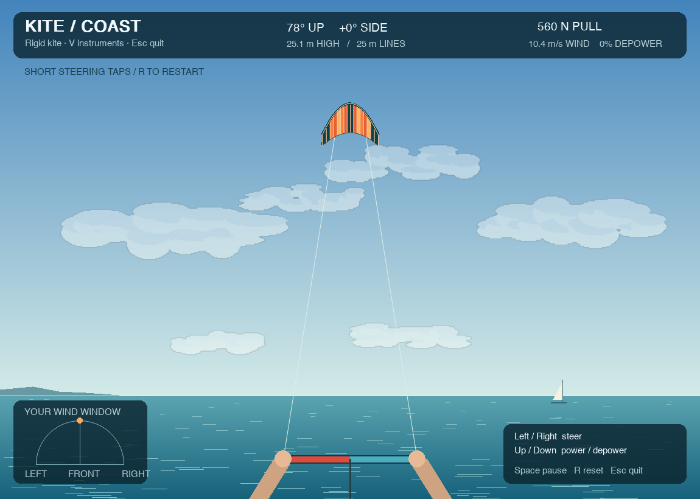

# Kite — a physics playground

Fly a kite with your keyboard against a fixed sky and coastline. Steer left or
right, change depower, and switch to an instrument view to see its position and
line forces. The kite has its own simulated attitude and rotational inertia,
so its nose can point in a different direction from its motion.



This is a standalone desktop simulator built with Python, NumPy and pygame-ce.
It runs locally without accounts, datasets, services or a GPU. The physics is
experimental: the default kite is an illustrative configuration, not a validated
model of a commercial kite.

## Quick start

Use **Python 3.12 or newer**. Download or clone this repository, then open a
terminal in its root folder, where `main.py` lives.

**macOS / Linux**

```sh
python3 -m venv .venv
source .venv/bin/activate
python -m pip install -r requirements.txt
python main.py
```

**Windows PowerShell**

```powershell
py -3 -m venv .venv
.\.venv\Scripts\python.exe -m pip install -r requirements.txt
.\.venv\Scripts\python.exe main.py
```

On Windows, use `.\.venv\Scripts\python.exe` in place of `python` in the commands
below. In an IDE, select the virtual environment's interpreter and run `main.py`.

## How to play

The kite starts already airborne near 70° elevation. Begin with short steering
taps; a held key requests 12 cm of motor travel, and releasing it centres the
steering target. The motor has a short delay and a smooth response, so
avoid immediately correcting every small motion. The camera stays fixed, and
an orange marker indicates when the kite leaves the view. The top-left label
shows whether LEFT/RIGHT is being received and the simulated flight time.
Holding a turn continuously can drive the kite into the ground; release or
countersteer before it dives.

| Key | Action |
| --- | --- |
| Left / A | Steer left |
| Right / D | Steer right |
| Up / W | Reduce depower toward fully powered |
| Down / S | Increase depower |
| V | Toggle rider / instrument view |
| Space | Pause / resume |
| R | Reset the kite and wind seed |
| Esc | Quit |

Depower stays at its target when you release the key. The game limits its
incidence change to 10° so steering remains usable at maximum depower; 100% here
means the end of this game range, not zero lift. Losing window focus pauses
the game. The instrument view shows individual line tensions; the rider view
shows their resultant pull.

If a line would need to push, the simulator stops with a **slack bridle line**
message. This is a boundary of the current taut-line model, not a simulated
recovery manoeuvre. Press R to restart. Ground contact also ends a flight.

Try repeatable gusts:

```sh
python main.py --turbulence 0.10 --seed 7
```

## What is simulated?

- Rigid-body translation and rotation, with a unit quaternion and full inertia tensor.
- Two independently constrained lines, including separate tension calculations.
- Lift and drag at three wing locations, using Fechner-style aerodynamic loads.
- Local rotational apparent wind, height-dependent wind and optional seeded gusts.
- Motor delay, smooth servo dynamics, rate/stroke limits and depower response.
- Differential side-surface incidence for responsive aerodynamic steering.

The model does not include flexible fabric, dynamic stall, line sag/drag, slack
recovery or reeling. Static polar tables and geometry are reference values and
placeholders. The mesh and short bridle branches are illustrative.

The complete [physics derivation](docs/PHYSICS.md) covers the Lagrangian,
rotational variations, line multipliers, quaternion conversion, aerodynamic
coefficients and numerical integration, with references and code mappings.

## Change the kite

Copy `configs/default.yaml`, change the copy, and pass it to the game:

```sh
python main.py --config configs/my_kite.yaml
```

Useful settings include `wind_speed`, `mass`, `area`, `line_length`, `width`,
`height` and the two body-frame `attachments`. Steering response can be adjusted
with `steering_twist_deg`, `motor_omega` and `motor_zeta`. Increasing servo speed
can cause large line-acceleration demands, especially when depowered. Body positions are relative to
the centre of mass. `inertia: null` estimates the inertia from four mass points;
a supplied symmetric 3×3 tensor overrides that estimate. Configuration changes
can make the initial two-line geometry infeasible or the flight unstable.

The simulation uses 5 ms steps by default, independently of the rendering loop.
Changing `dt` also requires `steering_delay` to contain a whole number of steps.
See `python main.py --help` for all command-line options.

## Tests and headless rendering

```sh
python -m unittest discover -s tests -v
python main.py --smoke 600 --screenshot outputs/smoke.png
```

The second command renders about ten simulated seconds without opening a window,
prints the average frame cost, saves the final frame and returns a nonzero exit
status if the flight stops unexpectedly. Headless results do not guarantee the
same performance on every computer. This snapshot was checked with Python 3.14,
NumPy 2.5.3, pygame-ce 2.5.8 and PyYAML 6.0.3.

If a window cannot open, check that you are in a desktop session; use `--smoke`
for remote machines. Install **pygame-ce**, which supplies the `pygame` import,
rather than installing both pygame distributions into the same environment.

## Repository layout

```text
main.py                  Game launcher
requirements.txt         Runtime dependencies
configs/default.yaml     Illustrative kite settings
kite_sim/physics/        Pure NumPy mechanics and aerodynamics
kite_sim/app/            Keyboard input and rendering
tests/                   Mechanics and display checks
docs/PHYSICS.md           Full derivation and scientific sources
```

The entire application lives in this repository; no parent folder is required.
Scientific sources and adaptations are credited in the derivation and source
modules.

For troubleshooting, the terminal prints the exact launcher and configuration
paths at startup, and the stop reason, steering and depower when a flight ends.
Use those paths to check that you are testing the files you edited.
